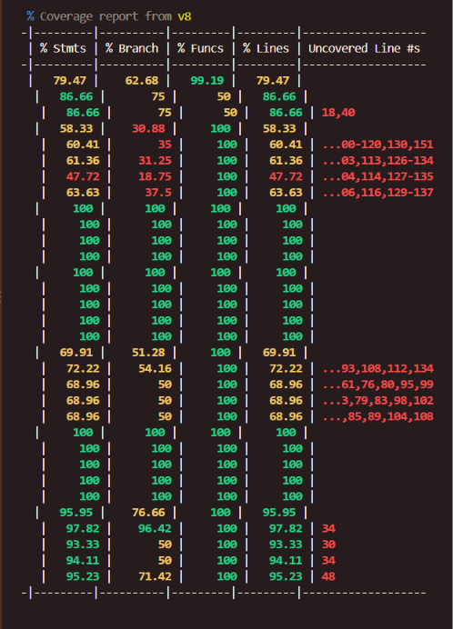

# Salão de Beleza – API REST

## Descrição

API REST para gerenciamento de um salão de beleza. O domínio escolhido é o de agendamento de serviços de beleza, e o problema que a API resolve é a organização manual de atendimentos: controlar quais serviços o salão oferece, quais profissionais atendem e quando cada cliente está agendado, evitando dois atendimentos do mesmo profissional no mesmo horário.

O objetivo da API é permitir o cadastro e a consulta de categorias, serviços, profissionais e agendamentos, aplicando regras de negócio e validações sobre os dados.

## Integrantes

- Ana Paula Micheletti
- Evelyn Louise da Silva de Souza

## Tecnologias

- Node.js
- TypeScript
- Express
- Supabase (PostgreSQL)
- Vitest
- Supertest
- Swagger/OpenAPI (swagger-jsdoc e swagger-ui-express)
- Git e GitHub

## Entidades e relacionamentos

### Categoria
- id
- name
- description
- active

### Serviço
- id
- category_id
- name
- description
- price
- duration_minutes
- active

### Profissional
- id
- name
- specialty
- phone
- active

### Agendamento
- id
- service_id
- professional_id
- client_name
- client_phone
- appointment_date
- appointment_time
- status

### Relacionamentos
- Uma categoria possui vários serviços (1:N).
- Um serviço pode aparecer em vários agendamentos (1:N).
- Um profissional pode possuir vários agendamentos (1:N).

## Regras de negócio

- Nome da categoria, nome e especialidade do profissional, e nome e categoria do serviço são obrigatórios.
- O preço do serviço deve ser um número maior ou igual a zero.
- A duração do serviço deve ser um número inteiro maior que zero.
- Um agendamento exige serviço, profissional, nome e telefone do cliente, data e horário.
- O status de um agendamento novo é `agendado` quando não informado.
- Não é possível agendar com um serviço ou profissional inexistente ou inativo (retorna 400).
- Um profissional não pode ter dois agendamentos na mesma data e horário (retorna 409). Agendamentos com status `cancelado` não contam para o conflito.
- A mesma verificação de conflito é feita ao atualizar um agendamento.
- Buscar, atualizar ou remover um registro inexistente retorna 404.

## Estrutura do projeto

```text
src/
├── config/          # Conexão com o Supabase e configuração do Swagger
├── controllers/     # Recebem a requisição HTTP e devolvem a resposta
├── errors/          # Erros personalizados (ValidationError, NotFoundError, ConflictError)
├── models/          # Classes de domínio, com atributos e validações
├── repositories/    # Acesso ao banco de dados (Supabase)
├── routes/          # Definição das rotas e documentação OpenAPI
├── services/        # Regras de negócio (e testes unitários dos services)
├── test/            # Testes dos models e testes de integração
├── app.ts           # Configuração do Express
└── server.ts        # Inicialização do servidor
```

## Configuração e execução

```bash
git clone https://github.com/whtevy/Sal-o-de-Beleza---API.git
cd Sal-o-de-Beleza---API
npm install
```

1. Crie o arquivo `.env` na raiz, com base no `.env.example` (veja a seção de variáveis de ambiente).
2. Prepare o banco de dados (veja a seção Banco de dados).
3. Inicie a aplicação:

```bash
npm run dev
```

O servidor sobe em `http://localhost:3000`.

Para gerar e executar a versão compilada:

```bash
npm run build
npm start
```

## Variáveis de ambiente

O arquivo `.env.example` lista as variáveis necessárias:

```env
SUPABASE_URL=https://seu-projeto.supabase.co
SUPABASE_SECRET_KEY=sua-chave-aqui
```

Copie-o para `.env` e preencha com as credenciais do seu projeto Supabase. O arquivo `.env` não deve ser enviado ao Git.

## Banco de dados

O banco é PostgreSQL, hospedado no Supabase. Para criar a estrutura, execute o conteúdo de `database.sql` no SQL Editor do Supabase.

| Tabela | Chave primária | Chaves estrangeiras |
|---|---|---|
| `categories` | `id` (uuid) | – |
| `services` | `id` (uuid) | `category_id` → `categories(id)` |
| `professionals` | `id` (uuid) | – |
| `appointments` | `id` (uuid) | `service_id` → `services(id)`, `professional_id` → `professionals(id)` |

As chaves estrangeiras usam `on delete restrict`: o banco impede remover uma categoria que tenha serviços, ou um serviço ou profissional que tenha agendamentos.

O script também cria restrições `price >= 0` e `duration_minutes > 0`, e insere três categorias iniciais (Cabelos, Unhas e Estética).

## Endpoints da API

| Método | Endpoint | Descrição |
|---|---|---|
| GET | `/categories` | Lista todas as categorias |
| GET | `/categories/:id` | Consulta uma categoria |
| POST | `/categories` | Cadastra uma categoria |
| PUT | `/categories/:id` | Atualiza uma categoria |
| DELETE | `/categories/:id` | Remove uma categoria |
| GET | `/services` | Lista todos os serviços |
| GET | `/services/:id` | Consulta um serviço |
| POST | `/services` | Cadastra um serviço |
| PUT | `/services/:id` | Atualiza um serviço |
| DELETE | `/services/:id` | Remove um serviço |
| GET | `/professionals` | Lista todos os profissionais |
| GET | `/professionals/:id` | Consulta um profissional |
| POST | `/professionals` | Cadastra um profissional |
| PUT | `/professionals/:id` | Atualiza um profissional |
| DELETE | `/professionals/:id` | Remove um profissional |
| GET | `/appointments` | Lista todos os agendamentos |
| GET | `/appointments/:id` | Consulta um agendamento |
| POST | `/appointments` | Cadastra um agendamento |
| PUT | `/appointments/:id` | Atualiza um agendamento |
| DELETE | `/appointments/:id` | Remove um agendamento |

Principais códigos de resposta: `200` (sucesso), `201` (criado), `400` (dados inválidos), `404` (não encontrado), `409` (conflito de horário) e `500` (erro interno).

## Exemplos de requisições

### Criar categoria (POST /categories)

```json
{
  "name": "Cabelos",
  "description": "Corte, escova e tratamentos"
}
```

### Atualizar categoria (PUT /categories/:id)

```json
{
  "name": "Cabelos e Penteados",
  "active": true
}
```

### Criar serviço (POST /services)

```json
{
  "category_id": "UUID_DA_CATEGORIA",
  "name": "Corte feminino",
  "description": "Corte feminino com finalização",
  "price": 80,
  "duration_minutes": 60
}
```

### Atualizar serviço (PUT /services/:id)

```json
{
  "price": 90,
  "duration_minutes": 75
}
```

### Criar profissional (POST /professionals)

```json
{
  "name": "Camila Duarte",
  "specialty": "Cabeleireira",
  "phone": "41999999999"
}
```

### Atualizar profissional (PUT /professionals/:id)

```json
{
  "specialty": "Colorista",
  "active": true
}
```

### Criar agendamento (POST /appointments)

```json
{
  "service_id": "UUID_DO_SERVICO",
  "professional_id": "UUID_DO_PROFISSIONAL",
  "client_name": "Pandora Zuzu",
  "client_phone": "41999999999",
  "appointment_date": "2026-12-10",
  "appointment_time": "14:30"
}
```

### Atualizar agendamento (PUT /appointments/:id)

```json
{
  "appointment_date": "2026-12-11",
  "appointment_time": "15:30"
}
```

## Testes automatizados e cobertura

### Ferramentas
- Vitest (execução dos testes e cobertura, com `@vitest/coverage-v8`)
- Supertest (requisições HTTP nos testes de integração)

### Organização dos arquivos
- `src/services/*.test.ts`: testes unitários dos services, com os repositories simulados (mocks).
- `src/test/Category.test.ts`, `Service.test.ts`, `Professional.test.ts` e `Appointments.test.ts`: testes unitários dos models.
- `src/test/*.integration.test.ts`: testes de integração dos endpoints de cada entidade, usando o banco de dados.
- `src/services/api.test.ts`: testes de integração da API com os repositories simulados, cobrindo códigos HTTP e mensagens de erro.

### Como executar

```bash
npm test                 # todos os testes (unitários e de integração)
npm run test:watch       # modo observação
npm run test:coverage    # testes com relatório de cobertura
```

Para executar um arquivo específico:

```bash
npx vitest run src/services/AppointmentService.test.ts
npx vitest run src/test/Category.integration.test.ts
```

### Configuração necessária
- Dependências instaladas (`npm install`).
- Arquivo `.env` configurado, pois os testes de integração acessam o Supabase.
- A configuração do Vitest está em `vitest.config.ts`, com mínimo de 60% de cobertura em linhas, instruções, funções e branches. Testes, `server.ts` e a pasta `config/` ficam fora do relatório.

### Cuidados com o banco de dados
Os testes de integração gravam no banco configurado no `.env`. Cada teste cria registros com nomes únicos (gerados com `randomUUID`) e remove os dados criados ao final, o que permite executá-los várias vezes sem interferência. Recomenda-se usar um projeto Supabase de desenvolvimento, e não o de produção.

### Relatório de cobertura

O relatório completo é gerado em `coverage/index.html`. Na última execução, os 107 testes (11 arquivos) passaram, com a seguinte cobertura:

| Métrica | Cobertura | Mínimo exigido |
|---|---|---|
| Statements | 79,47% | 60% |
| Branches | 62,68% | 60% |
| Functions | 99,19% | 60% |
| Lines | 79,47% | 60% |



## Documentação Swagger

Com a aplicação em execução, acesse:

```text
http://localhost:3000/api-docs
```

A raiz (`http://localhost:3000`) redireciona para essa página. Nela é possível ver todos os endpoints agrupados por entidade, consultar os parâmetros, os schemas e os códigos de resposta, e testar cada rota pelo botão **Try it out**.